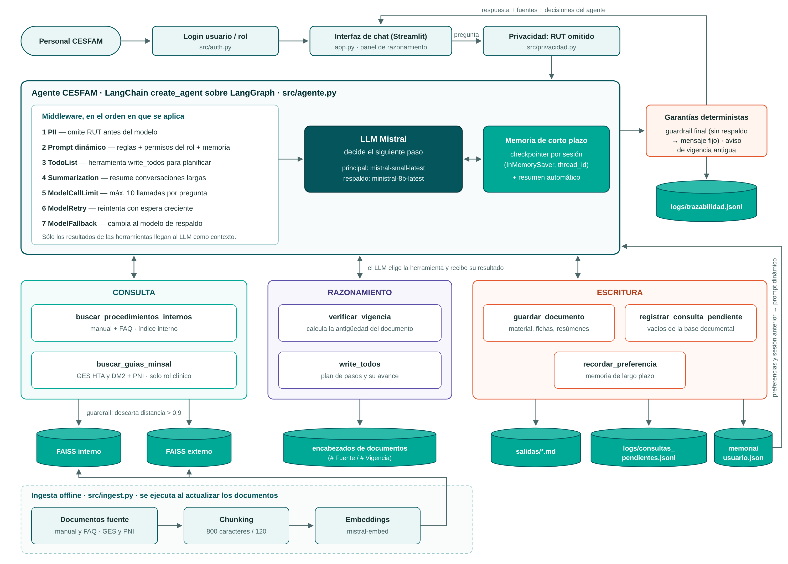
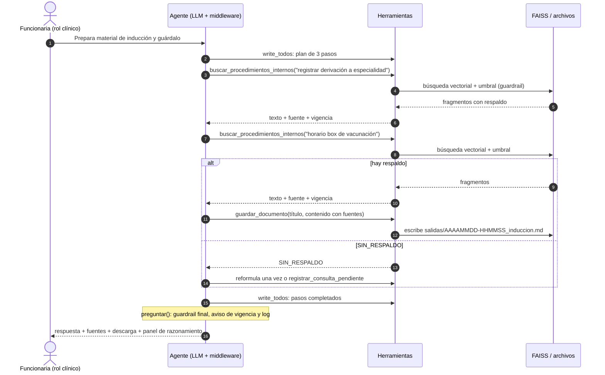

# Agente inteligente CESFAM Lo Franco — EP2

Proyecto de la asignatura ISY0101 Ingeniería de Soluciones con IA (Duoc UC).
Integrantes: Jose Salvatierra, Isabel Calles. Docente: Cristián Cárcamo.

Agente de apoyo interno para el personal del CESFAM Lo Franco. Responde
consultas sobre procedimientos internos, guías GES (hipertensión, diabetes
tipo 2) y el calendario de vacunación PNI 2026. Siempre cita la fuente y su
vigencia. Además puede **planificar tareas de varios pasos, escribir
documentos, recordar preferencias entre sesiones y ajustar su comportamiento**
según el rol del usuario, la falta de respaldo documental o una falla de la API.

**Qué cambió respecto de la EP1:** el flujo fijo de `rag_chain.py`
(palabras clave → búsqueda → guardrail → respuesta) se reemplazó por un agente
de LangChain (`create_agent`, sobre LangGraph) que decide en cada paso qué
herramienta usar. Ver la [tabla de cambios](#cambios-respecto-de-la-ep1).

---

## Contenido

1. [Instalación](#instalación)
2. [Ejecución](#ejecución)
3. [Arquitectura y orquestación](#arquitectura-y-orquestación)
4. [Herramientas: consulta, razonamiento y escritura](#herramientas-consulta-razonamiento-y-escritura)
5. [Memoria y recuperación de contexto](#memoria-y-recuperación-de-contexto)
6. [Planificación y toma de decisiones](#planificación-y-toma-de-decisiones)
7. [Ejemplo de flujo de trabajo](#ejemplo-de-flujo-de-trabajo)
8. [Pruebas y evidencias](#pruebas-y-evidencias)
9. [Evaluación con LangSmith](#evaluación-con-langsmith)
10. [Estructura del proyecto](#estructura-del-proyecto)
11. [Decisiones de diseño](#decisiones-de-diseño)
12. [Privacidad, seguridad y limitaciones](#privacidad-seguridad-y-limitaciones)

---

## Instalación

Requisitos: Python 3.10 a 3.13 y una API key gratuita de Mistral
(https://console.mistral.ai/). Opcionalmente, una API key gratuita de
LangSmith (https://smith.langchain.com/) para observabilidad y evaluación
(ver [Evaluación con LangSmith](#evaluación-con-langsmith)); sin ella el
agente funciona igual.

```bash
# 1. Clonar el repo y entrar a la carpeta
git clone https://github.com/iscalles/cesfam-rag-agent.git
cd cesfam-rag-agent

# 2. Crear y activar un entorno virtual
python -m venv .venv
.venv\Scripts\activate          # Windows
source .venv/bin/activate       # Mac / Linux

# 3. Instalar dependencias (si vienes de la EP1, el --upgrade es obligatorio)
pip install -r requirements.txt --upgrade

# 4. Configurar la API key
copy .env.example .env          # Windows  (Mac/Linux: cp .env.example .env)
# Abrir .env y pegar la key en LLM_API_KEY (y, si vas a usar LangSmith,
# LANGSMITH_API_KEY + LANGSMITH_TRACING=true)
```

## Ejecución

```bash
# 1. Construir los índices vectoriales (una vez, o cuando cambien los documentos)
python -m src.ingest

# 2. Levantar la demo
streamlit run app.py

# 3. Correr las pruebas automatizadas (no usan la API ni gastan cuota)
python -m pytest -v

# 4. Generar evidencia con la API real (10 escenarios; o uno con --solo N)
python -m scripts.escenarios
```

La app abre en `http://localhost:8501`.

| Usuario | Contraseña | Rol | Herramientas |
| --- | --- | --- | --- |
| `enfermera.jefa` | `cesfam2026` | clinico | todas |
| `admin.cesfam` | `cesfam2026` | administrativo | todas menos `buscar_guias_minsal` |

Cada respuesta muestra sus fuentes y un panel **"🧠 Cómo lo resolvió el
agente"** con el plan, las herramientas en orden y las decisiones tomadas.
La barra lateral muestra las herramientas del rol y la memoria de largo plazo.

---

## Arquitectura y orquestación



Fuente editable: [`docs/orquestacion.svg`](docs/orquestacion.svg).

### Módulos y cómo se integran

| Módulo | Responsabilidad | Recibe de | Entrega a |
| --- | --- | --- | --- |
| `app.py` | Login, chat, panel de razonamiento, descargas | Usuario | `AgenteCESFAM.preguntar()` |
| `src/auth.py` | Valida usuario y contraseña (SHA-256) y entrega el rol | `app.py` | `app.py` |
| `src/agente.py` | Orquesta: arma el agente, ejecuta el turno, aplica garantías y registra el log | `app.py` | `app.py`, `logs/` |
| `src/herramientas.py` | Las 6 herramientas propias y el filtro por rol | Agente (LLM) | Agente (texto + artefacto) |
| `src/memoria.py` | Memoria de largo plazo por usuario (JSON) | Herramientas, cierre de sesión | Prompt dinámico |
| `src/privacidad.py` | Detecta y omite RUT | `app.py`, agente, herramientas | — |
| `src/ingest.py` | Chunking + embeddings + índices FAISS | `data/` | `vector_store/` |
| `src/config.py` | Modelos, rutas, umbrales, permisos por rol | — | Todos |

### Ciclo de una pregunta

1. `app.py` recibe la pregunta y la pasa a `AgenteCESFAM.preguntar()`.
2. `privacidad.anonimizar()` omite cualquier RUT.
3. El grafo de LangGraph ejecuta el ciclo del agente:
   el **middleware** prepara la llamada (prompt dinámico con rol y memoria,
   resumen si la conversación es larga, límites, reintentos y modelo de
   respaldo) → el **LLM** decide si llama una herramienta o responde → la
   herramienta se ejecuta y su resultado vuelve al LLM → se repite hasta la
   respuesta final o el límite de 10 llamadas.
4. `preguntar()` revisa el turno completo y aplica dos **garantías
   deterministas**: si ninguna búsqueda tuvo respaldo, reemplaza la respuesta
   por el mensaje fijo; si se citó un documento antiguo, agrega el aviso de
   vigencia.
5. Se registra todo en `logs/trazabilidad.jsonl` y se devuelve a la interfaz
   la respuesta, las fuentes, los pasos, el plan, los documentos y las decisiones.

### Middleware del agente (orden de aplicación)

| # | Middleware | Qué hace |
| --- | --- | --- |
| 1 | `PIIMiddleware("rut")` | Segunda barrera: borra RUT de la entrada antes del modelo |
| 2 | `dynamic_prompt` | Prompt de sistema + permisos del rol + memoria de largo plazo, recalculado en cada llamada |
| 3 | `TodoListMiddleware` | Agrega la herramienta `write_todos` para planificar |
| 4 | `prompt_sistema_como_texto` (propio) | Deja el prompt de sistema en texto plano para la API de Mistral |
| 5 | `SummarizationMiddleware` | Sobre 30 mensajes, resume los antiguos y conserva los 12 últimos |
| 6 | `ModelCallLimitMiddleware` | Máximo 10 llamadas al modelo por pregunta |
| 7 | `ModelRetryMiddleware` | 2 reintentos con espera creciente (2 s, 4 s) |
| 8 | `ModelFallbackMiddleware` | Si el modelo principal falla, usa `ministral-8b-latest` |

Además, un `InMemoryRateLimiter` compartido limita las llamadas a la API
(0,5 por segundo por defecto) para respetar el plan gratuito de Mistral.

---

## Herramientas: consulta, razonamiento y escritura

| Tipo | Herramienta | Qué hace | Lee / escribe | Rol |
| --- | --- | --- | --- | --- |
| Consulta | `buscar_procedimientos_internos` | Busca en manual y FAQ; descarta fragmentos sobre el umbral 0,9 | Lee FAISS interno | ambos |
| Consulta | `buscar_guias_minsal` | Busca en GES HTA, GES DM2 y PNI; descarta fragmentos sobre el umbral | Lee FAISS externo | clínico |
| Razonamiento | `verificar_vigencia` | Calcula la antigüedad del documento; sobre 5 años lo marca REVISAR | Lee encabezados de `data/` | ambos |
| Razonamiento | `write_todos` | Plan de pasos con estado (pendiente, en curso, completado) | Estado del agente | ambos |
| Escritura | `guardar_documento` | Escribe un Markdown descargable con aviso de validación | Escribe `salidas/*.md` | ambos |
| Escritura | `registrar_consulta_pendiente` | Anota consultas sin respaldo para el equipo de documentación | Escribe `logs/consultas_pendientes.jsonl` | ambos |
| Escritura | `recordar_preferencia` | Guarda una preferencia estable del usuario | Escribe `memoria/<usuario>.json` | ambos |

Las búsquedas devuelven un **artefacto** con las fuentes (archivo, vigencia,
estado, distancia). La interfaz dibuja las tarjetas de fuentes con ese
artefacto, así que las fuentes se muestran aunque el modelo olvide citarlas.

---

## Memoria y recuperación de contexto

| Memoria | Mecanismo | Alcance | Dónde |
| --- | --- | --- | --- |
| Corto plazo | Checkpointer `InMemorySaver` con un `thread_id` por sesión: cada pregunta llega con el historial completo | Sesión abierta | `src/agente.py` |
| Corto plazo, conversaciones largas | `SummarizationMiddleware`: desde 30 mensajes resume los antiguos y conserva los 12 últimos | Sesión abierta | `src/agente.py` |
| Largo plazo | JSON por usuario con preferencias, documentos más consultados y consultas de la sesión anterior | Entre sesiones | `src/memoria.py`, `memoria/` |

**Recuperación de contexto en preguntas de seguimiento:** en la EP1 la
búsqueda usaba solo la última pregunta, así que "¿y a los 18 meses?" podía
quedar sin respaldo. Ahora el LLM escribe la consulta de búsqueda usando el
historial ("vacunas de los 18 meses calendario PNI"); la regla 4 del prompt
lo exige.

**Continuidad entre sesiones:** al cerrar sesión, `cerrar_sesion()` guarda las
últimas consultas. En la sesión siguiente se agregan al prompt, y si el
usuario dice "quiero retomar lo de ayer", el agente parte desde ahí.

---

## Planificación y toma de decisiones

| Condición | Comportamiento del agente | Mecanismo | Prueba |
| --- | --- | --- | --- |
| Pregunta simple con respaldo | 1 búsqueda en el índice adecuado y respuesta con cita | LLM elige la herramienta | `test_consulta_clinica_usa_guias_y_cita_fuente` |
| Tarea de 3 o más pasos | Plan con `write_todos`, varias búsquedas, documento escrito, plan cerrado | `TodoListMiddleware` | `test_tarea_multipaso_planifica_consulta_y_escribe` |
| Pregunta de seguimiento | Reescribe la consulta con el contexto anterior | Checkpointer + regla 4 | `test_memoria_corto_plazo_mantiene_el_hilo` |
| Sin respaldo documental | No responde con contenido propio; registra la consulta como pendiente | Filtro en la herramienta + garantía final | `test_sin_respaldo_reemplaza_respuesta_y_registra_pendiente` |
| Documento antiguo | Advierte que la guía debe revisarse | `estado_vigencia` + garantía final | `test_consulta_clinica_...`, `test_vigencia_marca_documentos_antiguos` |
| Usuario administrativo | No recibe la herramienta clínica y deriva la consulta | Filtro de herramientas + prompt por rol | `test_rol_administrativo_cambia_herramientas_y_prompt` |
| Preferencia del usuario | La guarda y la respeta en sesiones futuras | `recordar_preferencia` + prompt dinámico | `test_memoria_largo_plazo_entre_sesiones` |
| RUT en la pregunta | Lo omite antes del modelo, del log y de la memoria | `privacidad.py` + `PIIMiddleware` | `test_rut_no_llega_al_modelo_ni_al_log` |
| API con error 429 | Cambia al modelo de respaldo | `ModelFallbackMiddleware` | `test_falla_del_modelo_principal_usa_respaldo`, `test_error_429_cambia_al_modelo_de_respaldo` |
| API caída del todo | Avisa sin caerse y abre un hilo limpio | `try/except` en `preguntar()` | `test_falla_total_informa_sin_caerse` |
| Conversación muy larga | Resume lo antiguo y sigue coherente | `SummarizationMiddleware` | `test_conversacion_larga_se_resume` |

---

## Ejemplo de flujo de trabajo

Tarea: *"Prepara un material de inducción sobre derivaciones y el box de
vacunas, y guárdalo"* (escenario 4 de `scripts/escenarios.py`).



Versión en imagen: [`docs/flujo_tarea.png`](docs/flujo_tarea.png).

---

## Pruebas y evidencias

| Archivo | Qué prueba | Usa la API |
| --- | --- | --- |
| `tests/test_herramientas.py` | Cada herramienta por separado: privacidad, vigencia, guardrail, permisos, escritura, memoria | No |
| `tests/test_agente.py` | El agente completo con un modelo simulado que sigue un guion: 10 escenarios de decisión | No |
| `tests/test_integracion_api.py` | Clientes reales contra un servidor local que imita a Mistral: formato de solicitudes y 429 → respaldo | No |
| `scripts/escenarios.py` | Los mismos escenarios con la API real; guarda `evidencias/escenarios_<fecha>.md` | Sí |

Las pruebas automatizadas usan embeddings deterministas (bolsa de palabras) y
un umbral ajustado a ellos: prueban la **lógica** del guardrail, no su
calibración con `mistral-embed`.

Evidencias en [`evidencias/`](evidencias/): resultado de `pytest` y, al
ejecutar el script, los escenarios con la API real. El log
`logs/trazabilidad.jsonl` registra cada interacción con sus herramientas,
fuentes, decisiones, modelo y duración.

---

## Evaluación con LangSmith

El agente puede trazarse y evaluarse automáticamente con LangSmith (ver
[`docs/langsmith.md`](docs/langsmith.md) para la explicación completa:
qué es, cómo se implementó y por qué se usan 3 evaluadores propios en vez
de las métricas RAGAS genéricas). Es opcional y externo al pipeline de
respuesta: sin configurarlo, el agente funciona exactamente igual.

```bash
# 1. (Opcional) crear cuenta gratuita en https://smith.langchain.com/ y
#    pegar la API key en .env (LANGSMITH_API_KEY, LANGSMITH_TRACING=true)

# 2. Construir los índices si no existen
python -m src.ingest

# 3. Correr el dataset de prueba (7 preguntas) con los evaluadores propios
python scripts/evaluar_langsmith.py
```

Sin `LANGSMITH_API_KEY`, el script corre igual en modo local y deja la
evidencia en consola + `scripts/resultados_evaluacion.json`. Usa un
usuario de evaluación dedicado (`eval.langsmith`) y borra su archivo de
memoria de largo plazo al terminar, para no mezclarlo con `memoria/` del
personal real.

---

## Estructura del proyecto

```
app.py                       Interfaz Streamlit: login, chat, razonamiento, descargas
src/
  config.py                  Modelos, rutas, umbrales, permisos por rol
  auth.py                    Autenticación usuario/rol
  ingest.py                  Chunking + embeddings + índices FAISS
  agente.py                  Agente LangChain: middleware, turno, garantías, log
  herramientas.py            Herramientas de consulta, razonamiento y escritura
  memoria.py                 Memoria de largo plazo por usuario
  privacidad.py              Detección y omisión de RUT
scripts/escenarios.py        Escenarios con la API real → evidencias/
scripts/evaluar_langsmith.py Dataset + evaluadores propios (IL1.4)
tests/                       Pruebas automatizadas (pytest), sin API
data/internal, data/external Documentos fuente con # Fuente y # Vigencia
docs/
  orquestacion.png / .svg    Diagrama de orquestación de componentes
  flujo_tarea.png / .mmd     Ejemplo de flujo de trabajo (secuencia)
  prompts.md                 Prompt de sistema y descripciones de herramientas
  langsmith.md               Observabilidad y evaluación con LangSmith (IL1.4)
  ep1/                       Diagrama y prompts de la EP1 (referencia)
evidencias/                  Resultados de pruebas y escenarios
salidas/                     Documentos que escribe el agente (no se versionan)
memoria/                     Memoria de largo plazo por usuario (no se versiona)
logs/                        Trazabilidad y consultas pendientes (no se versionan)
```

---

## Decisiones de diseño

| Decisión | Dónde |
| --- | --- |
| Agente con `create_agent` de LangChain v1 (sobre LangGraph) en vez de un flujo fijo | `src/agente.py` |
| El LLM elige la herramienta; ya no hay enrutador por palabras clave | `src/herramientas.py` (descripciones) |
| Guardrail dentro de las herramientas de búsqueda + garantía final fuera del modelo | `herramientas._buscar`, `agente._analizar_turno` |
| Permisos de herramientas por rol | `config.PERMISOS_POR_ROL` |
| Memoria de corto plazo con checkpointer + resumen; largo plazo en JSON por usuario | `agente.py`, `memoria.py` |
| Planificación explícita con `write_todos` solo para tareas de 3 o más pasos | `PROMPT_PLANIFICACION` |
| Reintentos, modelo de respaldo y limitador de solicitudes | `agente.py`, `config.py` |
| Pruebas con modelo simulado y servidor local, sin consumir la API | `tests/` |

**Justificación:** la desarrolla el equipo en el informe técnico (sección de
justificación de decisiones), sin apoyo de IA, como exige la pauta.

### Cambios respecto de la EP1

| EP1 | EP2 |
| --- | --- |
| Flujo fijo en `rag_chain.py` | Agente con herramientas en `agente.py` + `herramientas.py` |
| Enrutador por palabras clave | El LLM elige la herramienta según su descripción |
| Solo consulta | Consulta, razonamiento y escritura |
| Memoria: últimos 6 mensajes | Checkpointer + resumen automático + memoria de largo plazo |
| La búsqueda usaba solo la última pregunta | El LLM reescribe la consulta con el contexto |
| El rol solo se mostraba | El rol define qué herramientas tiene el agente |
| El log podía guardar un RUT | RUT omitido antes del modelo, del log, la memoria y los documentos |
| Error 429 → aviso | Reintentos + modelo de respaldo + limitador de solicitudes |
| Sin pruebas automatizadas | 21 pruebas con pytest + script de escenarios |

---

## Privacidad, seguridad y limitaciones

- **Datos de pacientes:** el agente no los pide ni los procesa. Los RUT se
  omiten antes de llegar al modelo, al log, a la memoria y a los documentos
  (Ley N.º 20.584 y Ley N.º 19.628). Nombres o domicilios no se detectan
  automáticamente: el prompt prohíbe procesarlos y la FAQ instruye al personal.
- **Acceso:** login por usuario/rol con contraseñas en SHA-256 sin sal,
  suficiente para el piloto académico; en producción correspondería el SSO
  institucional.
- **Fuentes:** los documentos externos son resúmenes del equipo a partir de
  las guías oficiales; los internos son simulados.
- **Umbral 0,9:** es un punto de partida definido en la EP1; falta
  calibrarlo con un conjunto de preguntas con y sin respaldo.
- **Memoria de corto plazo en RAM:** se pierde si se reinicia la app; la de
  largo plazo sí persiste.
- **Cuota de la API:** cada pregunta puede usar varias llamadas; con el plan
  gratuito pueden aparecer límites de uso (el agente reintenta y cambia de modelo).
- Proyecto académico: no usar con datos reales de pacientes ni conectar a
  sistemas productivos del CESFAM.

## Declaración de uso de IA

Se utilizó Claude (Anthropic) como apoyo para estructurar y programar el
agente, las pruebas, los diagramas y la documentación técnica descriptiva.
Las decisiones de diseño, la validación del contenido, las justificaciones
técnicas y las conclusiones son del equipo.
[Ajustar esta declaración a lo que efectivamente usaron ambos integrantes.]
